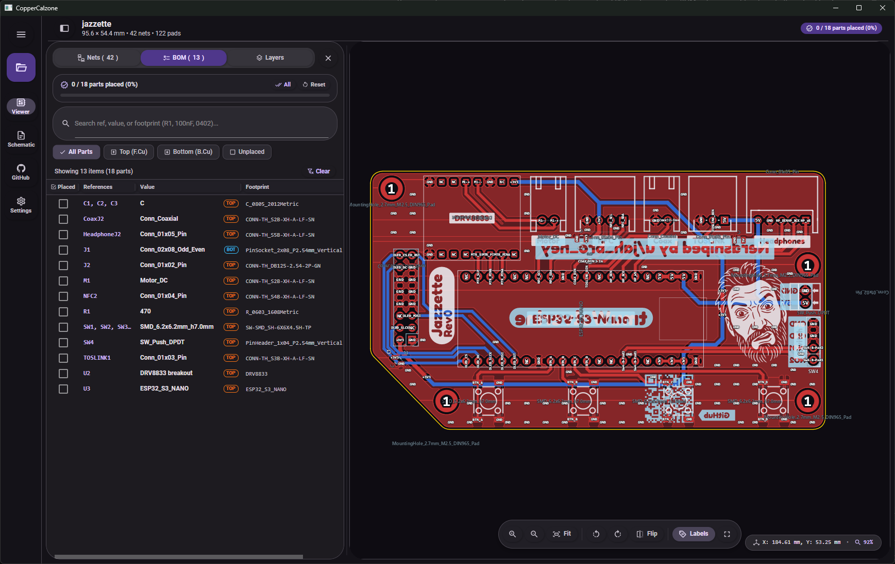

# Copper Calzone

A KiCad PCB, schematic, and interactive BOM viewer built with C# and Avalonia for **Windows** and **Android**.

I built this as a personal tool for assembling boards—mostly so I could open a PCB on a tablet straight from GitHub without having to manually generate and copy iBOM HTML files around. It's a work in progress (and mostly vibecoded), so expect rough edges.



## Features

- **Local & GitHub loading** – Open `.kicad_pcb` files from disk, or sign into GitHub (device flow) to browse your repositories and load boards directly.
- **PCB viewer** – Pan, zoom, rotate, flip the board, toggle individual layers or presets, change zone rendering modes, and inspect nets/pins on click or hover.
- **Assembly BOM** – Filter by side or unplaced parts, search components, check off placed parts with an assembly progress counter, and cross-probe parts on the board and schematic.
- **Schematic viewer** – Automatically discovers and loads `.kicad_sch` sheets (including sub-sheets) alongside a board, with cross-probing and placement highlighting.

## Downloads

Prebuilt Windows (`CopperCalzone-win-x64.zip`) and Android (`CopperCalzone.apk`) binaries are published on the [Releases](https://github.com/TemuWolverine/CopperCalzone/releases) page.

## Building from source

Requires the **.NET 11 SDK** (preview). Android builds also need **JDK 21** and the .NET Android workload (`dotnet workload install android`).

**Run on Windows:**
```sh
dotnet run --project src/CopperCalzone.Desktop
```

**Publish Windows Native AOT:**
```sh
dotnet publish src/CopperCalzone.Desktop/CopperCalzone.Desktop.csproj -c Release -r win-x64 -p:PublishAot=true
```

**Build Android APK:**
```sh
dotnet publish src/CopperCalzone.Android/CopperCalzone.Android.csproj -c Release -f net11.0-android
```

## License

[MIT](LICENSE)